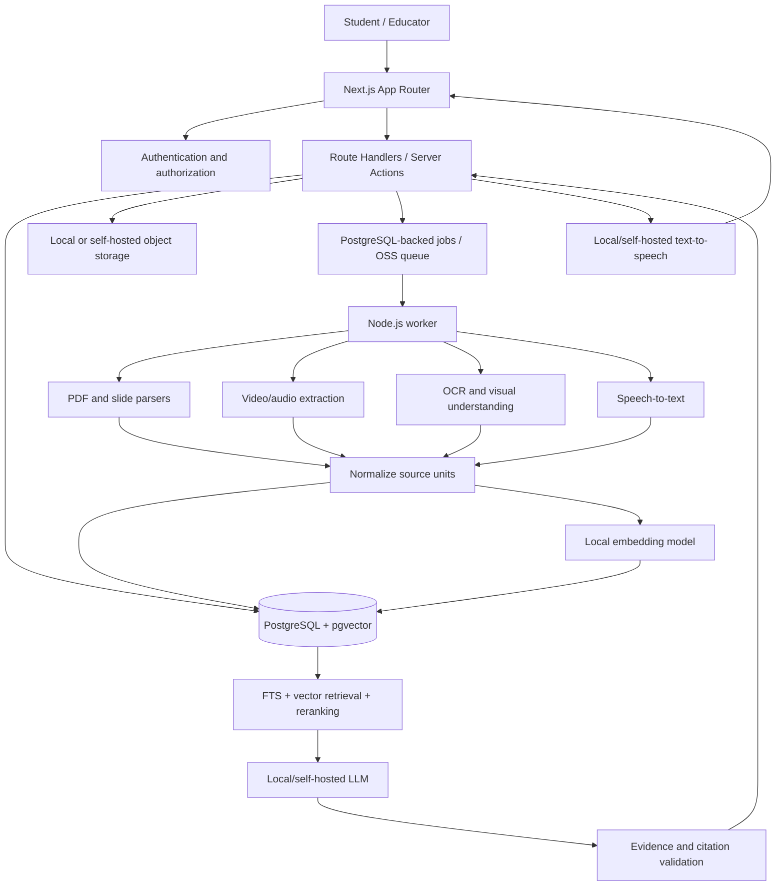

# System Architecture

## Architecture decision

Use a TypeScript-first Turborepo monorepo. PostgreSQL is both the relational system of record and the RAG retrieval store. Use PostgreSQL full-text search and `pgvector`; do not deploy a separate vector database in the baseline architecture.

## High-level architecture



## Monorepo layout

```text
omnitutor-ai/
├── apps/
│   ├── web/                       # Next.js App Router + React
│   └── worker/                    # Node.js ingestion and async jobs
├── packages/
│   ├── db/                        # Prisma schema, migrations, DB client
│   ├── contracts/                 # Zod schemas and shared DTOs
│   ├── retrieval/                 # PostgreSQL FTS, pgvector, ranking, citations
│   ├── ai/                        # Local model/provider adapters and prompts
│   ├── ingestion/                 # PDF, slide, image, video normalization
│   ├── learner-model/              # BKT and revision scheduling adapters
│   ├── assessments/               # Generation, verification, novelty
│   ├── audio/                     # ASR/TTS/session orchestration
│   ├── ui/                        # Shared React components
│   └── config/                    # Shared TS/lint/test config
├── infra/
│   └── docker-compose.yml         # PostgreSQL with pgvector
├── docs/
├── .env.example
├── package.json
└── turbo.json
```

## Service responsibilities

### Next.js application
- Course and asset management
- Upload initiation and processing progress
- Grounded chat with citations and source viewer
- Assessment UX, feedback, and mastery dashboard
- Audio capture/playback and transcript display
- Authentication and server-side authorization

### Node.js worker
- Durable ingestion and media jobs
- PDF/slide extraction and video/audio orchestration
- OCR/vision and ASR model adapters
- Normalized source-unit creation
- Chunking, embedding, and PostgreSQL indexing
- Assessment verification and retry handling

### PostgreSQL + Prisma + pgvector
- Authoritative relational state
- Source-unit and chunk metadata
- Embedding vectors and similarity search
- PostgreSQL full-text search
- Retrieval filters, citations, conversation records, assessments, and learner events

### Local/self-hosted AI components
- Text embedding model
- LLM for grounded answer generation and assessment generation
- OCR/vision model for figures and diagrams
- ASR for lecture and user audio
- TTS for spoken tutoring output

Each model is accessed through a typed adapter. Choose weights only after checking their licenses and hardware requirements. No paid API is required by the design.

## Ingestion pipeline

1. Validate file signature, type, size, and access rights.
2. Store original asset outside the public web root.
3. Create an idempotent job keyed by asset checksum and pipeline version.
4. Extract PDF pages, slide content, video metadata, audio, and selected frames.
5. Run OCR/vision and ASR as applicable.
6. Normalize results into source units with page/slide/time provenance.
7. Split large text into retrieval chunks while preserving parent source IDs.
8. Assign topics/concepts and candidate prerequisite relations.
9. Generate embeddings and write vectors to PostgreSQL.
10. Index text for PostgreSQL full-text search.
11. Run quality checks and publish `READY`, `PARTIAL`, or `FAILED` with warnings.

## Grounded tutoring request flow

1. Authenticate user and verify course membership.
2. Retrieve candidate chunks using PostgreSQL FTS and vector similarity.
3. Merge/rerank candidates and preserve source locations.
4. Assess whether evidence sufficiently covers the question.
5. If insufficient, return an abstention or partial-support response.
6. Generate an answer constrained to retrieved evidence.
7. Validate citations and claim support.
8. Return answer, support status, and source-viewer links.
9. Store retrieval trace and output for evaluation.

## Audio flow

Audio input is a core interaction. Capture user speech, transcribe it with a local/self-hosted ASR adapter, send the transcript through the same PostgreSQL RAG pipeline, then synthesize the answer with TTS. Return audio, transcript, and citations together. Preserve segment timestamps where supported.

## Reliability

- Async jobs with bounded concurrency and retries
- Idempotency by asset checksum + pipeline version
- Dead-letter or terminal failure state for exhausted retries
- PostgreSQL transactions for assessment submissions and learner events
- Query timeouts, upload limits, per-user rate limits, and connection pooling
- Metrics for queue age, ingestion failure, retrieval latency, citation accuracy, and audio turn completion
